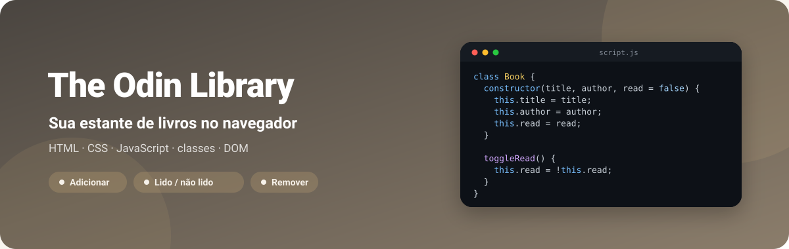
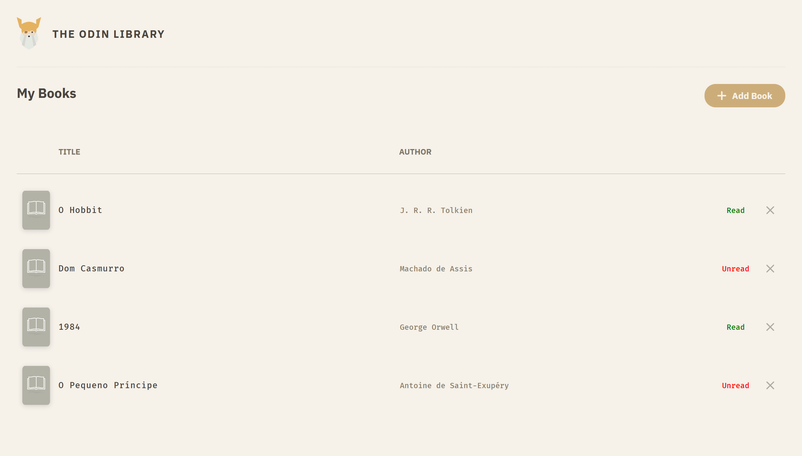
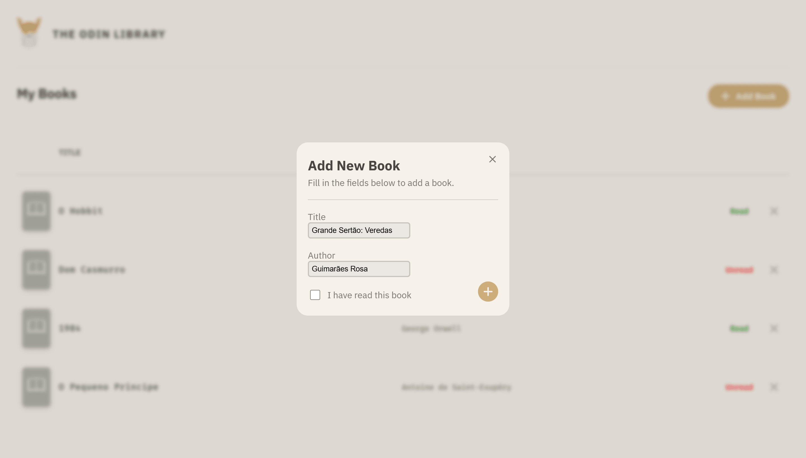
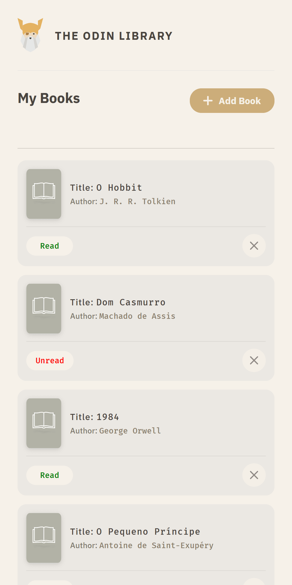

<div align="center">



**Estante de livros do The Odin Project: cadastre título e autor num modal, marque como lido ou não lido e remova com um clique.**

[](https://kessleru.github.io/TheOdin-Library/)
[](https://github.com/kessleru/TheOdin-Library/actions/workflows/pages/pages-build-deployment)
[](https://github.com/kessleru/TheOdin-Library/commits/main)



</div>

## Sobre

O projeto [Library](https://www.theodinproject.com/lessons/node-path-javascript-library) do
currículo de JavaScript do [The Odin Project](https://www.theodinproject.com). O objetivo é praticar
**manipulação do DOM** e **organização com classes**: cada livro é uma instância de `Book`, guardada
num array `myLibrary`, e cada item da lista é montado com `createElement` e `appendChild`.

Os livros vivem só em memória — ao recarregar a página, a estante volta vazia.

## Telas

### Adicionando um livro

O botão **Add Book** abre um modal com título, autor e a caixa "I have read this book". O modal
fecha pelo botão, ao enviar o formulário ou com um clique fora dele.



### Celular

<table>
<tr>
<td width="50%"></td>
<td width="50%">

Abaixo de 715px o cabeçalho da tabela some e cada livro vira um card, com os rótulos
**Title** e **Author** junto dos valores e as ações numa linha própria.

</td>
</tr>
</table>

## Funcionalidades

| | |
|---|---|
| ➕ **Adicionar** | Modal com título, autor e status de leitura |
| 🔁 **Lido / não lido** | Clique no status alterna entre **Read** e **Unread** chamando `book.toggleRead()` |
| ❌ **Remover** | Tira o livro do array e o item do DOM |
| 🪟 **Modal** | Fecha pelo botão, ao salvar ou com clique fora do conteúdo |
| 📱 **Responsivo** | Tabela no desktop, cards abaixo de 715px |

## Stack

| Camada | Ferramenta |
|---|---|
| Marcação | HTML5 |
| Estilo | CSS3, fontes [IBM Plex Sans e Fira Mono](https://fonts.google.com) |
| Lógica | JavaScript — classes, eventos e DOM |
| Deploy | [GitHub Pages](https://pages.github.com) |

## Rodando localmente

```bash
git clone https://github.com/kessleru/TheOdin-Library.git
cd TheOdin-Library
python -m http.server 8000
```

Abra `http://localhost:8000`. Não há dependências nem build — abrir o `index.html` direto no
navegador também funciona.

## Estrutura

```
├── index.html     # cabeçalho, lista #books e o modal com o formulário #add
├── script.js      # classe Book, myLibrary e renderização dos itens
├── css/
│   └── style.css
└── img/           # logo, capa genérica e ícones
```

<details>
<summary><b>Regerando as imagens deste README</b></summary>

```bash
node .github/readme/gerar.mjs                 # banner.svg

python -m http.server 8000                    # em outro terminal
npm i --no-save puppeteer-core sharp
node .github/readme/capturar.mjs              # cadastra livros pelo formulário e captura em 2x
```

</details>

---

<div align="center">
<sub>Feito por <a href="https://github.com/kessleru">Otávio Kessler Ustra</a> · projeto do <a href="https://www.theodinproject.com">The Odin Project</a></sub>
</div>
